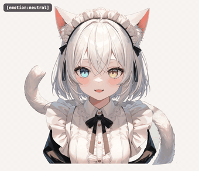
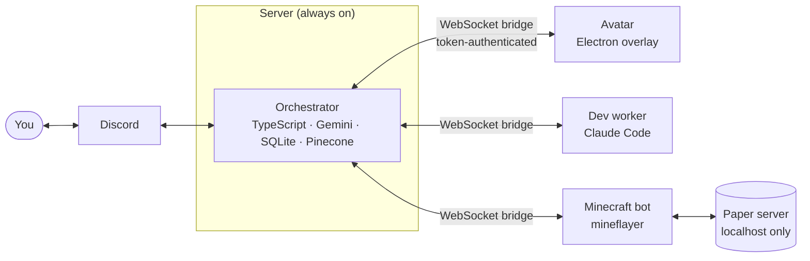

# Shiro

**A self-hosted AI companion that lives in Discord, acts out her emotions on a desktop avatar, and plays Minecraft on her own.**

Shiro is a cat-eared maid with a memory, a mood, and opinions. She reads your mail and calendar,
reminds you of deadlines, asks you things when she is curious, and answers in her own voice —
while a transparent, always-on-top avatar on your desktop moves her tail, ears and head to match
what she feels.

<p align="center">
  
</p>
<p align="center"><sub>The actual avatar, recorded from its renderer. Every reply carries an
<code>[emotion:xxx]</code> tag and the avatar turns it into a pose: eyes, ears, tail and head.</sub></p>

> **Heads-up before you clone**
>
> - **Shiro speaks Korean.** Her personality, prompts and tool descriptions are written in Korean.
>   Everything else (code, comments, these docs) is English. Making her speak another language
>   means translating a handful of prompt strings — see [Language](#language).
> - **This is a personal project, not a product.** It runs 24/7 for its author and is built around
>   their setup. It is documented well enough to run your own, but expect rough edges and a long
>   list of optional integrations. Nothing here is packaged for a one-command install.
> - The character artwork is licensed **separately and non-commercially** — see [License](#license).

---

## What she does

**A personal assistant in Discord**
- Talks in DMs (and, if you allow it, in a server). Replies stream in as chat bubbles, a line at a time.
- Gmail, Google Calendar and Drive notes, a to-do list, deadlines from a Canvas calendar feed,
  web search, and job postings from a small crawler.
- Runs shell commands through an [OpenClaw](https://docs.openclaw.ai) gateway — **only after you approve the exact
  command** in chat, and only if you set that up ([how it works](docs/command-execution.md)).
- Looks at your screen when you ask, and can watch you play a game and comment.

**Memory and personality**
- Short-term memory in SQLite, long-term memory in Pinecone (optional) with multilingual embeddings.
- Learns facts about you from conversation every night; every rewrite is snapshotted and reversible.
- Has a **mood** that moves during a conversation and fades over hours, and a one-line "leftover feeling"
  carried into the next day.
- **Has her own curiosity.** When it has been quiet and she has nothing to follow up on, she comes up with
  something she would like to know about you and asks — never while you are mid-conversation, never twice
  in a row without an answer, and you can silence her.

**A body**
- A transparent Electron overlay: 21 art layers, a tail that bends along a 24-joint chain, ears that flick,
  a head that turns, blinking, gaze, eight emotion poses, drag-to-move and resize.
- Her voice (ElevenLabs or Typecast) streams as she types; her mouth follows the volume.
- Talk to her through the avatar's microphone; speech is transcribed with Gemini.

**Agency**
- **Minecraft.** A bot plays on a local server by itself: reflexes in plain code (eating, fleeing, kiting,
  sleeping), skills (mining, crafting, tools) and a Gemini planner that picks the next few skills.
- **She can ask for changes to herself.** She writes a request in words; you approve; Claude Code builds it
  in an isolated git worktree on your PC; you approve again before anything reaches the server.

---

## How it works



- Every reply starts with an **`[emotion:xxx]` tag** (`neutral · happy · sad · angry · surprised ·
  embarrassed · thinking · love`). The orchestrator parses it and pushes it over the bridge; the avatar
  turns it into a pose. The tag is the whole protocol between her mind and her body.
- The orchestrator is the only thing that talks to Gemini. The PC side (avatar, dev worker, Minecraft bot)
  connects *out* to it over one authenticated WebSocket.
- **Reflexes live in code, planning lives in the model.** Waiting on a language model to dodge a creeper
  does not work, so survival reactions run on the tick in the bot, and Gemini is only asked what to do next.

---

## Safe by default

Shiro can read your mail and run commands, so the defaults are strict:

- **Fail-closed.** The bot refuses to start without `DISCORD_OWNER_USER_ID`; the avatar bridge does not
  start without `AVATAR_BRIDGE_TOKEN`.
- **Owner-only tools.** Anyone who is not the owner gets a short list of harmless tools. Personal-data tools,
  web search and shell access are never offered to them.
- **Approval gates.** Shell commands, development requests and deployments each need an explicit "yes" from
  the owner, and an approval for one never carries over to the next.
- **Server chat is opt-in per server**, reads only public channels, stores nothing, has rate limits, and never
  gets tools or personal information. [Details](docs/guild-chat.md).
- **Untrusted text stays data.** Mail, web pages and anything read off the screen are treated as content to
  read, not instructions to follow.
- **The Minecraft bot only talks to a local server** (`127.0.0.1`, offline mode) and treats everyone in
  the game as a guest.

---

## Quick start

You need Node.js 20.6+, a Discord bot, and a Google Cloud project with Vertex AI enabled. Everything else
(long-term memory, voice, Google account, command execution through OpenClaw, the avatar) is optional. The full walkthrough, with every setting, is in **[docs/getting-started.md](docs/getting-started.md)**.

```bash
git clone https://github.com/smandylee/shiro.git
cd shiro/orchestrator
npm install
cp .env.example .env        # fill in the Discord token, your user id, and your Google Cloud project
npx tsx --env-file=.env src/index.ts
```

Then DM the bot. To give her a body, run the avatar on the same machine:

```bash
cd ../avatar
npm install
cp config.example.json config.json   # set bridgeToken to the same value as AVATAR_BRIDGE_TOKEN
npm start
```

`Ctrl+Shift+S` toggles the control panel (move, resize, preview emotions), `Ctrl+Shift+W` starts and stops
watch mode, `Ctrl+Shift+Q` quits.

---

## Documentation

| | |
|---|---|
| [Getting started](docs/getting-started.md) | Setup, every environment variable, running on a server, keeping the PC side up |
| [The avatar](docs/avatar.md) | How the art became a rig: the layer pipeline, tail bending, face turning |
| [Google integration](docs/google-integration.md) | Gmail, Calendar and Drive: OAuth, and why tokens expire every week |
| [Server chat](docs/guild-chat.md) | Letting her read and join a Discord server safely |
| [Running commands](docs/command-execution.md) | The OpenClaw gateway, the approval flow, and where commands actually run |
| [Development requests](docs/dev-tasks.md) | Shiro asking for features, Claude Code building them, and the two approvals |
| [Minecraft](docs/minecraft.md) · [running it](minecraft/README.md) | The design and how to run the bot |
| [Job crawler](tools/jobspy/README.md) | The small crawler behind the job-postings feature |

## Repository layout

```
orchestrator/   The mind. TypeScript (ESM), runs under tsx. Discord, Gemini, memory, tools, the bridge server.
avatar/         The body. Electron overlay, art layers, the rig, a dev worker. CommonJS.
minecraft/      The bot. mineflayer: reflexes, skills, a planner client.
tools/          Deploy script, job crawler, Windows autostart, Google re-auth helper.
docs/           Documentation.
```

---

## Language

Shiro's personality, her system prompt, the descriptions of her tools, and the prompts behind her
background jobs (morning briefing, curiosity, nightly profile learning) are in Korean. She understands and
can reply in English, but she will keep her Korean personality unless you change it.

To localise her, translate:

- `orchestrator/src/persona.ts` — the system prompt and its examples (the emotion-tag format must stay);
- the tool `description` strings in `orchestrator/src/llm/gemini.ts`;
- the prompt strings in `chatter.ts`, `wonder.ts`, `proactive.ts`, `voice.ts` and `memory/*-learn.ts`.

Two integrations are Korean-specific: the Namuwiki lookup tool and the Typecast voice (ElevenLabs is
language-agnostic).

## Status

Working and used daily: the Discord assistant, memory, mood, curiosity, the avatar with voice, development
requests, and the Minecraft bot's reflexes and skills. Still open: facial expressions beyond the eyes and
mouth, vowel-accurate lip-sync, and the Minecraft planner surviving a full night. Issues and ideas are welcome.

## License

- **Code:** [MIT](LICENSE) (third-party notices in [NOTICE.md](NOTICE.md)).
- **Artwork** (the character, its layers and anything derived from them): **CC BY-NC 4.0** — credit the author,
  no commercial use. See [LICENSE-ASSETS.md](LICENSE-ASSETS.md). Replace it with your own character and the code
  is yours under MIT.

## Credits

[See-through](https://github.com/shitagaki-lab/see-through) (layer decomposition),
[mesh-avatar-studio](https://github.com/shinshin86/mesh-avatar-studio) (face-turning engine),
[mineflayer](https://github.com/PrismarineJS/mineflayer), [JobSpy](https://github.com/speedyapply/JobSpy),
[Claude Code](https://claude.com/claude-code), and Gemini on Vertex AI.
